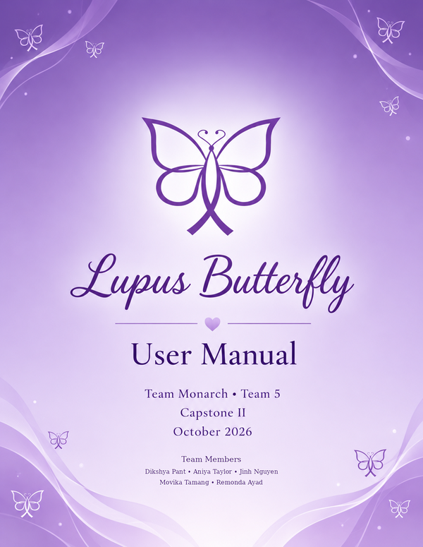

# Lupus Butterfly – User Manual

**Version:** 0.1.0

**Team Name:** Team Monarch

**Team Number:** Team 5

**Course:** Capstone II, University of North Texas

**Date:** 10/11/2026

**Team Members:** Dikshya Pant, Aniya Taylor, Jinh Nguyen, Movika Tamang, Remonda Ayad

---

## 1. Introduction

Lupus Butterfly is an Android app that helps people with lupus take their medication consistently. Patients log each dose and earn **Butterfly Bucks** for taking it on time, build day-to-day streaks, and watch their butterfly grow from a chrysalis into a butterfly. Clinicians use the same app to see which patients have not logged a dose today, so they can follow up early. Turning a daily routine into a simple game makes it easier to stay on track with treatments like hydroxychloroquine.

---

## 2. System Requirements

- **Hardware:**
  - A Windows, macOS or Linux computer that can run Android Studio (at least 8 GB of RAM, 16 GB recommended, and about 10 GB of free disk space)
  - An Android phone running **Android 8.0 (API 26) or newer**, *or* an Android emulator on the computer
  - An active internet connection (the app saves your data to the cloud)
- **Software:**
  - [Android Studio](https://developer.android.com/studio) (current version)
  - Android SDK and an emulator system image for **API 34**, both installed from inside Android Studio
  - Git (optional; you can download the code as a ZIP instead)
- **Other Dependencies:**
  - None to set up yourself. The app already connects to the team's live Supabase cloud database, so no account, API keys or settings file are needed. Android Studio downloads all code libraries automatically.
- **Tested On:** Pixel 8 emulator running Android 14 (API 34)

---

## 3. Installation Guide

Lupus Butterfly is a native Android app. It is not a website, so it must be installed on a phone or emulator. You install it by opening the project in Android Studio and pressing **Run**.

1. **Get the source code.** Open a terminal and run:
   `git clone https://github.com/dikshyapant/capstone-spring-2026.git`
   - No Git? Open the [project repository](https://github.com/dikshyapant/capstone-spring-2026), click **Code → Download ZIP**, and unzip the file.
2. **Open the project in Android Studio.** Start Android Studio, click **Open**, and select the folder
   `capstone-spring-2026/Source_Code/Frontend/mobile/ButterflyApp`.
   - Select the **ButterflyApp** folder itself, not the top-level folder. Android Studio only recognizes the project from this folder.
3. **Wait for the Gradle sync to finish.** Android Studio downloads everything the app needs. The first sync can take several minutes. If it asks to upgrade the Android Gradle Plugin (AGP) or Gradle, accept.
4. **Set up a device to run the app on.** Choose one:
   - **Emulator (recommended):** open **Device Manager**, click **+** to create a virtual device, and choose a Pixel phone with the **API 34** system image.
   - **Your own Android phone:** go to **Settings → About phone** and tap **Build number** seven times to unlock Developer options. Turn on **USB debugging**, connect the phone by USB, and tap **Allow** when asked.

   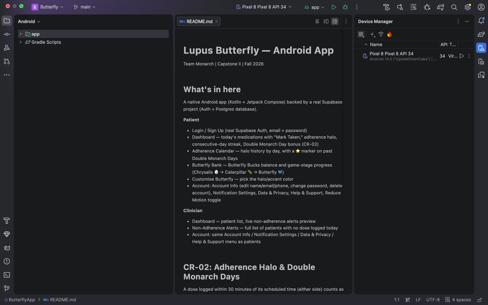

5. **Run the app.** Choose your device in the toolbar at the top of Android Studio and click **Run ▶**. Android Studio builds the app, installs it and opens it on the device.

   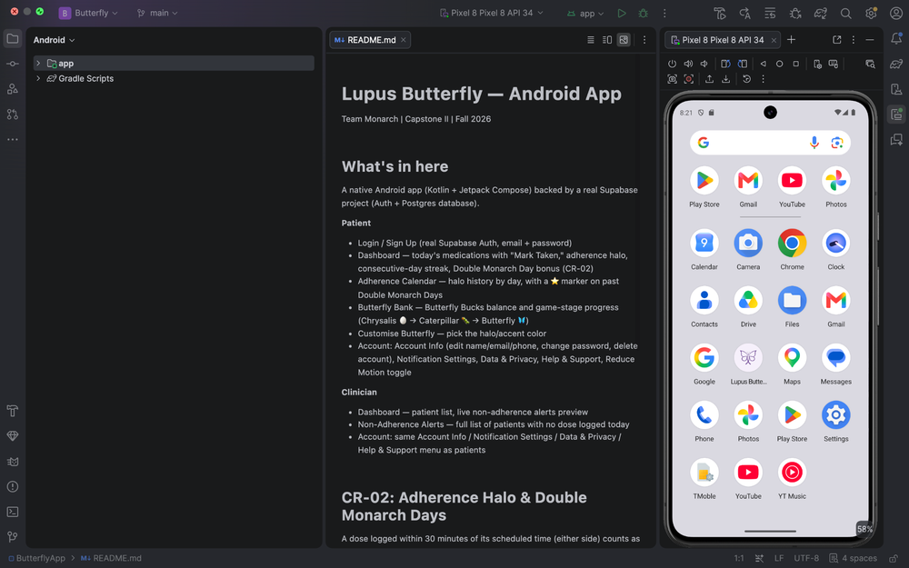

6. **Check that it worked.** The app opens on the **Login** screen, and the **Lupus Butterfly** icon now appears in the device's app list.

> **Good to know:** The project has no command-line build scripts (`gradlew`), so always build and run it through Android Studio. After the first install, the app stays on the device and can be opened from its icon without Android Studio.

---

## 4. Getting Started

1. **Launch the app.** Tap the **Lupus Butterfly** icon on the home screen or in the app list.

   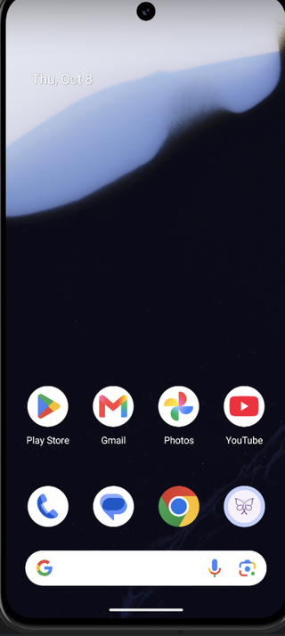 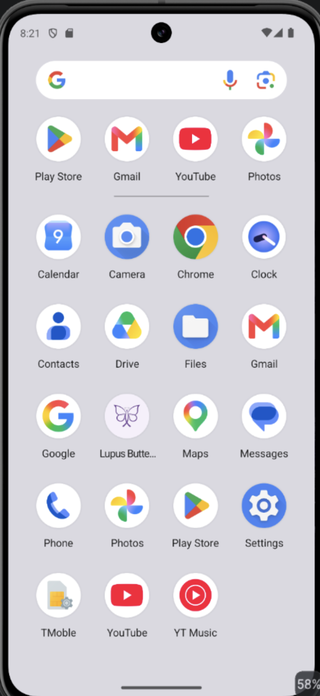

2. **Create an account.** On the Login screen, tap **Don't have an account? Sign up**. Fill in your **Full Name**, **Email Address**, **Password** and **Confirm Password**, then tap **Date of Birth** to pick your birthday. Under **I am a**, choose **Patient** (or **Clinician** if you are a doctor or care team member). Accept the Terms & Privacy Policy and tap **Create Account**.

   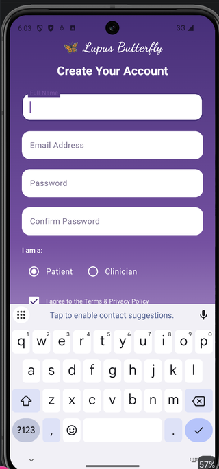

3. **Allow notifications.** The first time the app opens, Android asks whether Lupus Butterfly can send you notifications. Tap **Allow** so you can get medication reminders.

   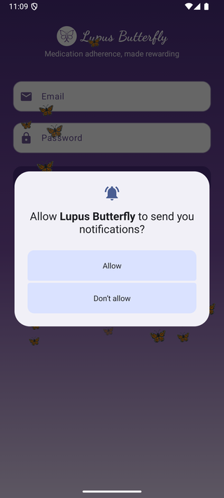

4. **Log in.** Enter your **Email** and **Password** and tap **Log In**. If the details are wrong, the app shows an error and keeps you on the Login screen.

   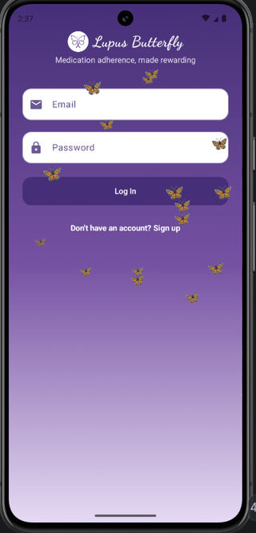

5. **Look around the Home screen.** After logging in, patients see:
   - A greeting, your **Butterfly Bucks (BB)** balance, a **bell** for notifications and a **profile** icon at the top
   - **Med Status:** your next scheduled dose and a **Log Dose** button
   - **Halo Streak:** how many days in a row you have taken your medication on time
   - Your **Butterfly Bucks** balance and current butterfly **stage**
   - Shortcut buttons: **Butterfly Bank**, **Adherence History** and **Customise Butterfly**

   The bar at the bottom moves between **Home**, **Bank**, **History** and **Settings**.

   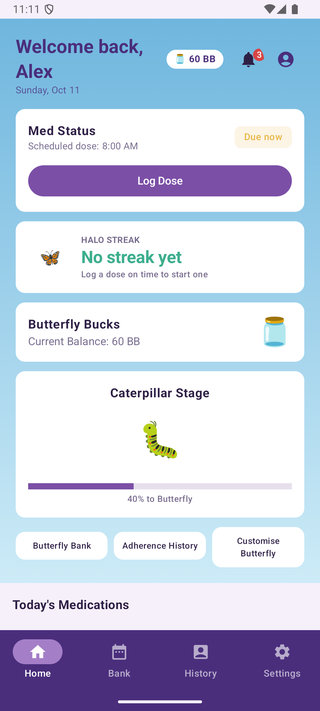

6. **Add your first medication.** Scroll down to **Add a Medication**, type the **Medication name** and its **Scheduled time** (for example, `8:00 AM`), and tap **Add Medication**. It appears under **Today's Medications**, and you are ready to start logging doses (Feature 1).

   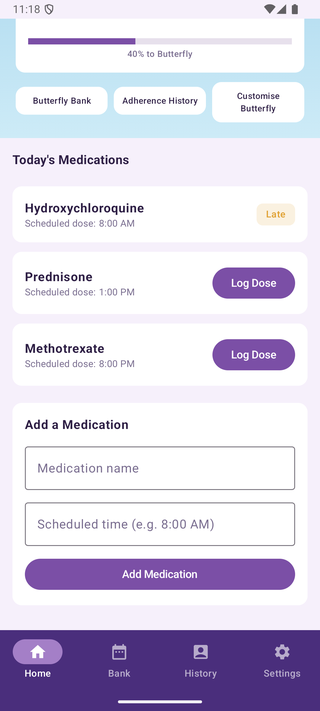

---

## 5. Features & Functions

### Feature 1: Logging a Dose

**What it does:** Records each dose you take and rewards you for taking it on time.

**How to use it:**

1. On the **Home** screen, tap **Log Dose** in the **Med Status** card, or next to the medication under **Today's Medications**.
2. The app records the dose and tells you how it counted:
   - **On time** (within the 1-hour window, 30 minutes before or after the scheduled time): +2 Butterfly Bucks, the adherence halo and streak credit.
   - **Late** (outside the window): +1 Butterfly Buck, but no halo or streak credit. The app shows "Logged as late (+1 BB)."
   - **Missed:** 0 Butterfly Bucks.
3. The medication shows an **On Time** or **Late** label, and your balance at the top updates right away.

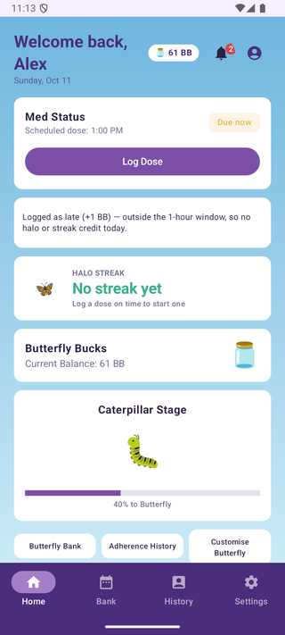

### Feature 2: Adherence History, Halo Streaks and Double Monarch Days

**What it does:** Every on-time day adds to your **Halo Streak**. Every **2nd consecutive** on-time day is a **Double Monarch Day**, which pays **4 Butterfly Bucks instead of 2**. The **Adherence History** calendar shows your record day by day.

**How to use it:**

1. Log your doses on time every day (Feature 1). Your streak appears in the **Halo Streak** card on the Home screen. If you have none yet, it says "No streak yet."
2. Tap **Adherence History** on the Home screen, or **History** in the bottom bar.
3. Read the calendar:
   - Days with a **glow** had an on-time dose.
   - A ⭐ marks a **Double Monarch Day** (2× reward).
   - Today is highlighted in purple.
   - Use the **‹ ›** arrows to switch months.

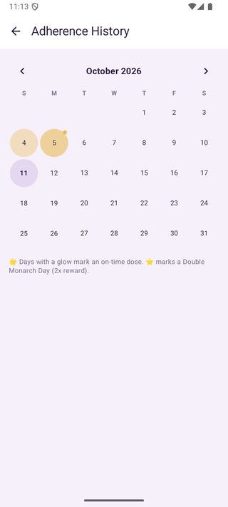

### Feature 3: Butterfly Bank

**What it does:** Shows how many Butterfly Bucks you have, your progress toward the next stage, and every reward you have earned. Your butterfly grows as your balance grows:

| Stage | Butterfly Bucks |
|-------|-----------------|
| 🥚 Chrysalis | 0–49 |
| 🐛 Caterpillar | 50–149 |
| 🦋 Butterfly | 150 or more |

**How to use it:**

1. Tap **Butterfly Bank** on the Home screen (or **Bank** in the bottom bar).
2. Under **Your Progress**, see your stage and how many Bucks you need for the next one (for example, "89 BB to reach Butterfly").
3. Under **Recent activity**, see each dose, whether it was on time or late, and what it earned.

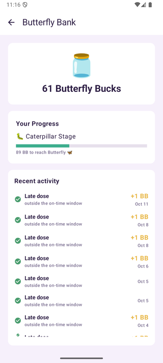

### Feature 4: Customise Butterfly

**What it does:** Lets you choose the color of your adherence halo on the Home screen.

**How to use it:**

1. Tap **Customise Butterfly** on the Home screen.
2. Under **Choose a Halo Color**, tap **Gold**, **Violet**, **Rose**, **Teal** or **Sky**. A check mark shows your choice, and the **Preview** updates right away.
3. Tap **←** to go back. Your halo uses the new color whenever your streak is active.

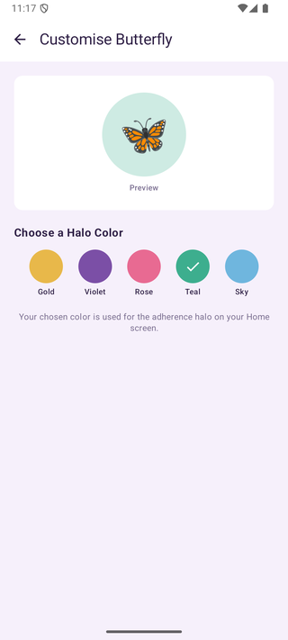

### Feature 5: Notifications and Reminders

**What it does:** Lists which doses are due and which have been logged, and lets you turn medication reminders on or off.

**How to use it:**

1. Tap the **bell** at the top of the Home screen. The red number shows how many notifications you have.
2. The **Notifications** list shows reminders such as "Time to take Prednisone" and confirmations such as "Hydroxychloroquine logged late."
3. Tap the **⚙ gear** in the top-right corner (or go to **Settings → Notification Settings**) and turn **Medication Reminders** on or off. This saves your preference to your account.
4. Tap **Send test notification** to check that your phone is allowing notifications from the app.

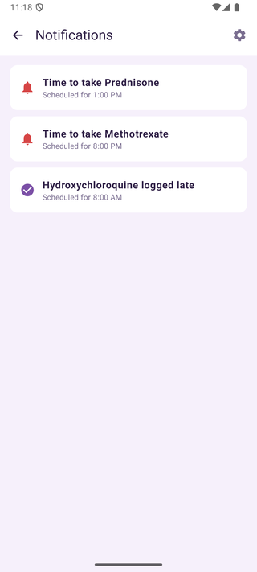
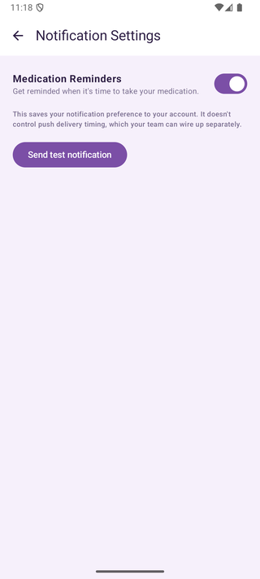

### Feature 6: Account and Settings

**What it does:** Lets you manage your profile, password and app preferences.

**How to use it:**

1. Tap **Settings** in the bottom bar. You will see:
   - **Account Information:** edit your **Name**, **Email**, phone **Number** and **Date of Birth**, then tap **Save Changes**. You can also **Change Password** or **Delete Account** here.
   - **Notification Settings:** see Feature 5
   - **Data & Privacy:** how your information is used
   - **Accessibility:** turn off the **Halo animation** if motion is distracting (your streak and rewards still count)
   - **Help & Support:** answers to common questions
2. Tap **Log Out** at the bottom to sign out.

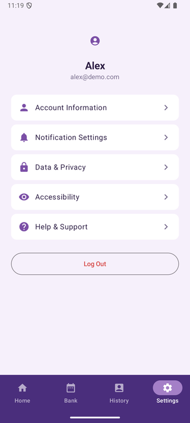
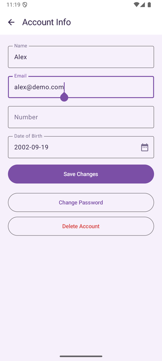

### Feature 7: Clinician Dashboard and Non-Adherence Alerts

**What it does:** Lets doctors and care teams see every patient's Butterfly Bucks and streak, and flags patients who have doses pending or who broke a streak.

**How to use it:**

1. Sign up or log in with a **Clinician** account. The bottom bar shows **Dashboard**, **Patients**, **Alerts** and **Settings**.
2. On the **Dashboard**:
   - Use **Search patients...** to find someone.
   - The **Non-Adherence Alerts** card previews patients with doses pending today and how many patients broke a streak this week.
   - **All Patients** lists each patient's email, Butterfly Bucks balance and current streak (for example, **1d** = 1-day streak).
3. Tap the **Non-Adherence Alerts** card (or **Alerts** in the bottom bar) for the full list. It shows how many doses each patient still has pending today (for example, "3 patients have a dose pending today") and which patients' streaks reset to 0 this week.

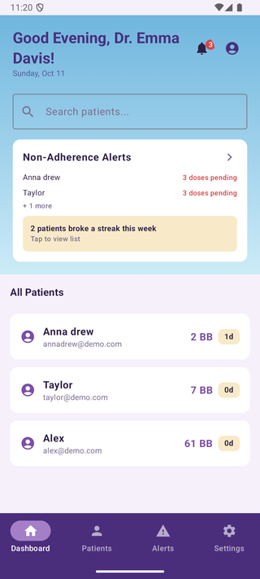
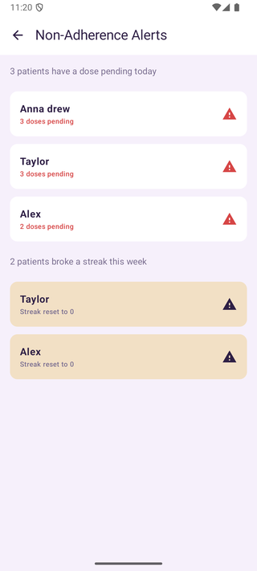

---

## 6. Troubleshooting

| Problem | Cause | Solution |
|---------|-------|----------|
| Android Studio will not open the project or shows sync errors | The wrong folder was opened, or the Gradle sync did not finish | Open the **ButterflyApp** folder (not the top-level folder), wait for the sync to finish, and accept any AGP/Gradle upgrade prompt. |
| App will not install or crashes on start | The build did not finish, or the device is out of storage | Free up storage on the device, then click **Run ▶** again in Android Studio. If that fails, uninstall the app from the device and run it again. |
| "Invalid login credentials" | Wrong email or password | Check the spelling of your email and password. If you forgot your password, contact support (Section 7). Once logged in, you can change it in **Settings → Account Information → Change Password**. |
| Screens are empty or data does not load | No internet connection | Connect to Wi-Fi or mobile data and reopen the app. On an emulator, check that the computer is online. |
| Not seeing notifications | Notifications are blocked by the phone, or turned off in the app | Turn on **Medication Reminders** in **Settings → Notification Settings**, then allow notifications in your phone's **Settings → Apps → Lupus Butterfly → Notifications**. Use **Send test notification** to check. |
| A dose was marked **Late** | It was logged outside the 1-hour window (more than 30 minutes before or after its scheduled time) | Log doses within 30 minutes of the scheduled time, and check that the scheduled time (AM/PM) is correct. |

---

## 7. Contact Information

- **Support Email:** jinhnguyen@my.unt.edu
- **Website:** Not applicable (Lupus Butterfly is an Android app, not a website)
- **Project Repository:** [github.com/dikshyapant/capstone-spring-2026](https://github.com/dikshyapant/capstone-spring-2026)
- **Other Support Channels:** **Help & Support** inside the app (**Settings → Help & Support**)

---

## 8. FAQ

**Q:** Do I need a Supabase account or API keys to run the app?

**A:** No. The app is already connected to the team's live, shared database. You only need Android Studio and an internet connection.

**Q:** Is there an iPhone version?

**A:** No. Lupus Butterfly runs on Android 8.0 or newer. If you do not have an Android phone, you can use the Android emulator in Android Studio.

**Q:** What counts as taking my medication "on time"?

**A:** Logging a dose within the 1-hour window: 30 minutes before or after its scheduled time. On-time doses earn 2 Butterfly Bucks and the halo, late doses earn 1, and missed doses earn 0.

**Q:** What is a Double Monarch Day?

**A:** Every 2nd day in a row that you take your medication on time. It pays 4 Butterfly Bucks instead of 2, and it is marked with a ⭐ on the Adherence History calendar.

**Q:** How does my butterfly grow?

**A:** It changes with your Butterfly Bucks balance: Chrysalis at 0–49, Caterpillar at 50–149 and Butterfly at 150 or more.

**Pro tip:** Turning off the **Halo animation** in **Settings → Accessibility** only stops the motion. Your streak, rewards and Double Monarch bonus still count.
